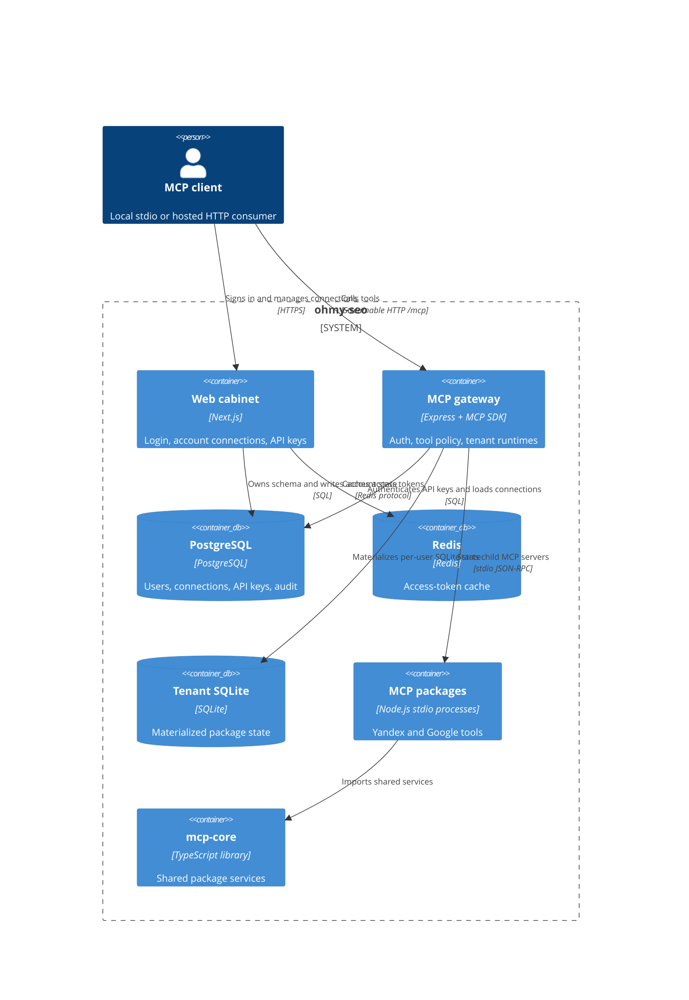

# ohmy-seo architecture

TL;DR: Local MCP package processes share infrastructure through `@ohmy-seo/mcp-core`; hosted requests pass through the web-managed account store and a gateway that starts those compiled package processes per tenant (`packages/core/package.json:5-32`, `hosting/apps/gateway/src/runtime.ts:95-153`).

## System context and containers

The workspace dependency is declared by pnpm's `packages/*` glob; each major MCP workspace declares `@ohmy-seo/mcp-core`, and the hosted gateway launches built package entry points (`pnpm-workspace.yaml:1-3`, `packages/ga4/package.json:15-18`, `packages/gtm/package.json:18-22`, `hosting/apps/gateway/src/runtime.ts:22-31`). The web, gateway, PostgreSQL, and Redis services are composed together; the gateway also mounts the tenant volume (`hosting/compose.yml:10-107`).

## Runtime request path

1. A hosted client sends a bearer key to `POST /mcp`; request security applies no-store headers, origin checks, and a per-IP window limiter (`hosting/apps/gateway/src/index.ts:17-24`, `hosting/apps/gateway/src/request-security.ts:20-31`).
2. The gateway hashes and resolves the API key to a user. Missing keys return 401, invalid keys 403, database failure 503, and per-user limit rejection 429 (`hosting/apps/gateway/src/index.ts:48-85`, `hosting/apps/gateway/src/tenant.ts:193-218`).
3. The gateway synchronizes fresh account tokens, writes them into that user's SQLite database, and starts only packages required by connected providers; shared SERP packages require `ENABLE_SHARED_SERP=true` (`hosting/apps/gateway/src/runtime.ts:49-56`, `hosting/apps/gateway/src/runtime.ts:108-153`, `hosting/apps/gateway/src/tenant.ts:112-179`).
4. The MCP server exposes the package tools that pass the gateway allowlist. Tool calls are policy-checked, dispatched to the owning child, and logged without user arguments or provider response text (`hosting/apps/gateway/src/tool-policy.ts:4-49`, `hosting/apps/gateway/src/runtime.ts:169-189`, `hosting/apps/gateway/src/tool-log.ts:1-32`).

## HTTP routes

| Method and path | Caller and behavior | Failure behavior |
|---|---|---|
| `GET /healthz` | Container/orchestrator probe; no API-key authentication; runs `SELECT 1` against PostgreSQL (`hosting/apps/gateway/src/index.ts:25-32`). | Returns 503 and `{ok:false}` if the database query fails (`hosting/apps/gateway/src/index.ts:27-31`). |
| `POST /mcp` | MCP client; requires a bearer API key or `x-api-key`, then handles one stateless Streamable HTTP request (`hosting/apps/gateway/src/index.ts:34-53`, `hosting/apps/gateway/src/index.ts:88-153`). | Missing key 401; invalid/revoked key 403; auth backend 503; rate limit 429; malformed JSON 400; oversized body 413 (`hosting/apps/gateway/src/index.ts:50-85`, `hosting/apps/gateway/src/index.ts:115-124`, `hosting/apps/gateway/src/index.ts:159-161`). |
| `GET /mcp` | MCP client transport probe; no API-key authentication (`hosting/apps/gateway/src/index.ts:150-156`). | Returns 405 because the endpoint is stateless (`hosting/apps/gateway/src/index.ts:150-156`). |
| `DELETE /mcp` | Stateless transport cleanup probe; no API-key authentication (`hosting/apps/gateway/src/index.ts:157`). | Returns 204; there is no resumable session to delete (`hosting/apps/gateway/src/index.ts:150-157`). |

The body is read as text and parsed with `parseJsonSafe`, preserving out-of-safe-range integer literals such as 19-digit Direct ad IDs (`hosting/apps/gateway/src/index.ts:21-23`, `hosting/apps/gateway/src/json-safe.ts:1-10`, `hosting/apps/gateway/src/json-safe.ts:108-110`).

## Related pages

- [System overview](overview.md)
- [Package map](packages.md)
- [Deployment](deployment.md)
- [Gateway and web operations](../hosting/OPERATIONS.md)

<!-- lane-pilot:backlinks -->
## Referenced by

- [ohmy-seo overview](overview.md)
- [Small MCP packages](packages.md)
- [ohmy-seo project map](project.md)
