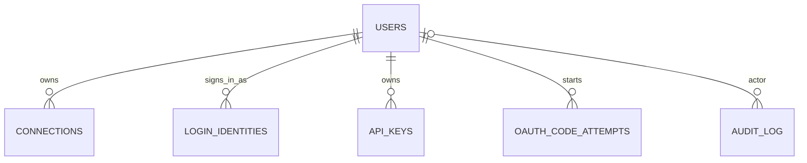

# ohmy-seo data model map

TL;DR: PostgreSQL is the hosted source of truth for cabinet users, OAuth connections, and API keys; SQLite package schemas belong to their workspaces, while gateway tenant databases are materialized runtime copies (`hosting/apps/web/src/lib/db.ts:18-105`, `hosting/apps/gateway/src/tenant.ts:112-179`).

## Hosted identity and access entities

This diagram maps relationships only; field meanings, status lifecycles, retention, and cleanup belong to the workspace that defines and operates each schema.

The web schema defines these six PostgreSQL tables and the displayed user foreign-key relationships (`hosting/apps/web/src/lib/db.ts:18-105`). Login identities are separate from revocable data connections; API key and connection rows cascade with user deletion, while audit rows set `user_id` to null (`hosting/apps/web/src/lib/db.ts:27-45`, `hosting/apps/web/src/lib/db.ts:59-103`). `audit_log.connection_id` is a nullable reference value with no declared foreign key (`hosting/apps/web/src/lib/db.ts:97-105`).

The gateway does not define another hosted schema. It waits for the web application's `api_keys` table, then reads the web-owned `connections` table and materializes provider rows in tenant SQLite (`hosting/apps/gateway/src/index.ts:164-185`, `hosting/apps/gateway/src/tenant.ts:26-81`, `hosting/apps/gateway/src/tenant.ts:112-179`). The derived account rows are removed when connections are revoked; expired cached provider responses are deleted during materialization and the full response cache is purged when a tenant runtime stops (`hosting/apps/gateway/src/tenant.ts:147-178`, `hosting/apps/gateway/src/tenant.ts:89-107`, `hosting/apps/gateway/src/runtime.ts:190-204`).

## Workspace-owned data models

Use the owning workspace's documentation for field tables, invariants, state transitions, readers, writers, and cleanup rules:

- [`@ohmy-seo/mcp-core` data model](../packages/core/docs/data-model.md) and its [credential](../packages/core/docs/data-model/credentials.md), [cache](../packages/core/docs/data-model/cache.md), and [inventory/rollback](../packages/core/docs/data-model/inventory-and-rollback.md) domain pages.
- [`@ohmy-seo/ga4` data model](../packages/ga4/docs/data-model.md) and [Google credentials](../packages/ga4/docs/data-model/google-credentials.md).
- [`@ohmy-seo/google-ads` data model](../packages/google-ads/docs/data-model.md) and [account credentials](../packages/google-ads/docs/data-model/account-credentials.md).
- [`@ohmy-seo/google-search-console` data model](../packages/google-search-console/docs/data-model.md) and [OAuth credentials](../packages/google-search-console/docs/data-model/oauth-credentials.md).
- [`@ohmy-seo/gtm` data model](../packages/gtm/docs/data-model.md) and [credentials/rollback](../packages/gtm/docs/data-model/credentials-and-rollback.md).
- [`@ohmy-seo/yandex-seo` overview](../packages/yandex-seo/docs/overview.md) links its package-owned data pages.

The root only maps hosted entities to package-owned state. It does not repeat package SQLite table schemas (`packages/core/docs/data-model.md`, `packages/ga4/docs/data-model.md`, `packages/google-ads/docs/data-model.md`, `packages/google-search-console/docs/data-model.md`, `packages/gtm/docs/data-model.md`).

<!-- lane-pilot:backlinks -->
## Referenced by

- [ohmy-seo overview](overview.md)
- [ohmy-seo project map](project.md)
