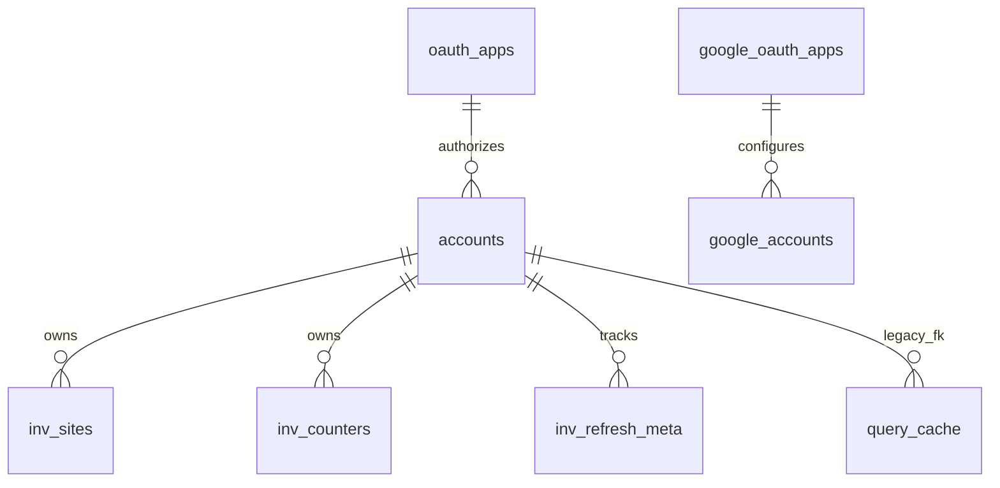

# Core Data Model

TL;DR: Core migrations create shared SQLite tables for Yandex and Google credentials, Yandex site/counter inventory, cached tool responses, and GTM rollback previews (`packages/core/src/db/migrations.ts:3-222`).

## Schema overview

Each package database receives the same migration set. The no-argument connection path uses the legacy Yandex database; named package paths are selected by package configuration (`packages/core/src/db/connection.ts:25-30`, `packages/core/src/db/connection.ts:44-60`).

`query_cache.account_id` is a soft reference after migration V4, not a foreign key. `gtm_rollback_plans.account_id` is an account identifier without a declared FK (`packages/core/src/db/migrations.ts:87-93`, `packages/core/src/db/migrations.ts:105-116`, `packages/core/src/db/migrations.ts:177-190`).

## Domain areas

| Tables | Meaning | Detail |
|---|---|---|
| `oauth_apps`, `accounts`, `google_oauth_apps`, `google_accounts` | Provider credentials and account selection | [Credentials](data-model/credentials.md) |
| `query_cache` | Serialized tool response cache and hit counters | [Cache](data-model/cache.md) |
| `inv_sites`, `inv_counters`, `inv_refresh_meta`, `gtm_rollback_plans` | Yandex inventory snapshots and GTM preview plans | [Inventory and rollback](data-model/inventory-and-rollback.md) |

## Migrations

| Version | Tables and change | Evidence |
|---|---|---|
| 1 | Creates Yandex `oauth_apps` and `accounts` | `packages/core/src/db/migrations.ts:3-27` |
| 2 | Creates inventory site, counter, and refresh metadata tables | `packages/core/src/db/migrations.ts:29-67` |
| 3 | Creates `query_cache` with account foreign key and indexes | `packages/core/src/db/migrations.ts:69-85` |
| 4 | Rebuilds cache without account FK, adds account namespace, adds Google credential tables and GTM rollback plans | `packages/core/src/db/migrations.ts:87-192` |

The connection opener runs migrations before returning a new connection; `applyMigrations` updates `user_version` after each earlier version transaction and sets version 4 after its idempotent work (`packages/core/src/db/connection.ts:33-41`, `packages/core/src/db/migrations.ts:194-222`).

## Retention and cleanup

Core defines no scheduled cleanup job for these tables. Cache expiration is checked during reads but expired rows remain until deletion is requested (`packages/core/src/cache/cache-policy.ts:130-136`, `packages/core/src/cache/query-cache-repo.ts:65-99`). GTM rollback plans are claimed and deleted by the rollback tool during confirmation; an expired plan that is never confirmed remains in the table (`packages/gtm/src/tools/gtm-rollback.ts:107-117`). Inventory snapshots are reconciled on refresh by deleting rows absent from the latest account response (`packages/yandex-seo/src/lib/db/inventory-repo.ts:97-103`, `packages/yandex-seo/src/lib/db/inventory-repo.ts:143-148`).

## Ownership

Core owns the DDL and connection lifecycle. Workspace repositories and tools perform domain reads/writes; their names and use cases are listed on the linked area pages (`packages/core/src/db/migrations.ts:3-222`, `packages/core/src/db/connection.ts:33-61`).

<!-- lane-pilot:backlinks -->
## Referenced by

- [SQLite Database Access](features/database.md)
- [MCP Core Overview](overview.md)
