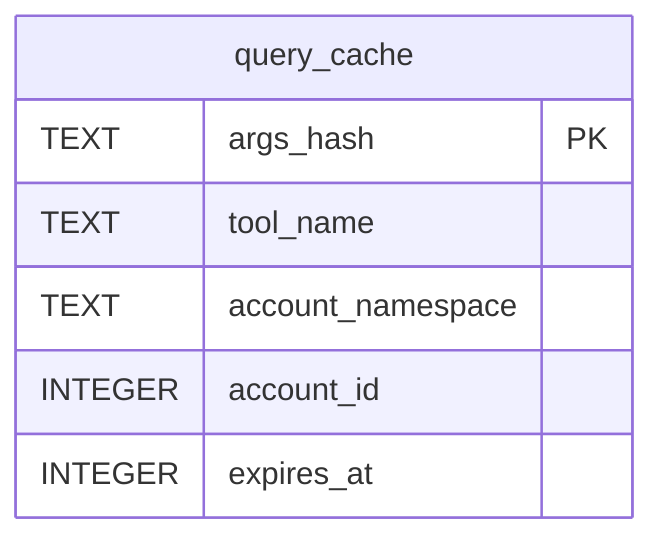

# Cache Data Model

TL;DR: `query_cache` stores serialized tool arguments and responses under a SHA-256 key, with expiry and hit metadata. Since migration V4, namespace and account IDs are informational columns without a foreign key (`packages/core/src/db/migrations.ts:105-140`).

## Table: `query_cache`

One row represents a cached response for one tool/account/argument identity (`packages/core/src/db/migrations.ts:105-116`).

| Field | Meaning | Evidence |
|---|---|---|
| `args_hash` | Primary cache identity; SHA-256 hex over tool, account ID, and canonical arguments excluding `force_refresh` | `packages/core/src/db/migrations.ts:106-106`, `packages/core/src/cache/cache-keys.ts:12-16` |
| `tool_name` | Tool key used for policy, reporting, and invalidation | `packages/core/src/db/migrations.ts:107-107`, `packages/core/src/cache/query-cache-repo.ts:69-72` |
| `account_namespace` | Optional provider/workspace namespace metadata | `packages/core/src/db/migrations.ts:108-108`, `packages/core/src/cache/cache-policy.ts:143-148` |
| `account_id` | Optional account identifier; V4 stores it without an FK | `packages/core/src/db/migrations.ts:109-109`, `packages/core/src/db/migrations.ts:87-93` |
| `args_json` | Canonical JSON identity fields kept for endpoint invalidation and inspection | `packages/core/src/db/migrations.ts:110-110`, `packages/core/src/cache/cache-policy.ts:141-149` |
| `response_json` | JSON serialization of the returned result | `packages/core/src/db/migrations.ts:111-111`, `packages/core/src/cache/cache-policy.ts:143-154` |
| `fetched_at`, `expires_at` | Unix timestamps in seconds for cache creation and validity boundary | `packages/core/src/db/migrations.ts:112-113`, `packages/core/src/cache/cache-policy.ts:128-152` |
| `hit_count` | Number of successful cache reads, initialized to zero | `packages/core/src/db/migrations.ts:114-114`, `packages/core/src/cache/query-cache-repo.ts:31-55` |
| `last_hit_at` | Unix seconds for latest successful hit; null until first hit | `packages/core/src/db/migrations.ts:115-115`, `packages/core/src/cache/query-cache-repo.ts:48-55` |

## Relationships

Migration V3 originally declared an account FK with cascade delete. V4 rebuilds the table without that FK and maps existing non-null account IDs to the `yandex` namespace (`packages/core/src/db/migrations.ts:69-85`, `packages/core/src/db/migrations.ts:105-140`).

## Status and lifecycle transitions

| Field | From | To | Function and when |
|---|---|---|---|
| `expires_at` | Entry created with `now + ttl` | Time crosses the expiry boundary; entry becomes a miss but remains stored | `withCache` checks `expires_at > now` on lookup; no expiry cleanup is attached (`packages/core/src/cache/cache-policy.ts:128-136`, `packages/core/src/cache/cache-policy.ts:140-154`). |
| `hit_count`, `last_hit_at` | `0`, `NULL` | Incremented count and current Unix seconds | `incrementHit` after a valid cache hit (`packages/core/src/cache/cache-policy.ts:130-135`, `packages/core/src/cache/query-cache-repo.ts:48-55`). |
| Entry row | Absent | Inserted/replaced | `putEntry` after a successful call and when `skipCacheIf` is false (`packages/core/src/cache/cache-policy.ts:138-155`, `packages/core/src/cache/query-cache-repo.ts:28-46`). |
| Entry row | Present | Deleted | Explicit `deleteWhere` or `deleteByEndpointPrefix` request (`packages/core/src/cache/query-cache-repo.ts:65-108`). |

## Invariants

- `args_hash` is the primary key and is deterministic for argument objects regardless of property order (`packages/core/src/db/migrations.ts:106-106`, `packages/core/src/cache/cache-keys.ts:3-16`).
- `account_namespace` is not part of the key calculation (`packages/core/src/cache/cache-policy.ts:126-128`, `packages/core/src/cache/cache-policy.ts:143-148`).
- Cache timestamps use Unix seconds (`packages/core/src/cache/cache-policy.ts:128-128`, `packages/core/src/cache/cache-policy.ts:140-152`).

## Writers and readers

`withCache` reads entries, updates hit metadata, invokes a caller function on misses, and writes eligible results. Workspace tools and explicit invalidation paths call the repository's deletion and reporting functions (`packages/core/src/cache/cache-policy.ts:114-155`, `packages/core/src/cache/query-cache-repo.ts:65-157`).

## Retention and cleanup

No scheduled cache cleanup is defined in core. Expired rows count in storage and statistics until a caller deletes them (`packages/core/src/cache/cache-policy.ts:130-136`, `packages/core/src/cache/query-cache-repo.ts:65-116`).

<!-- lane-pilot:backlinks -->
## Referenced by

- [Core Data Model](../data-model.md)
- [Core Response Cache](../features/cache.md)
