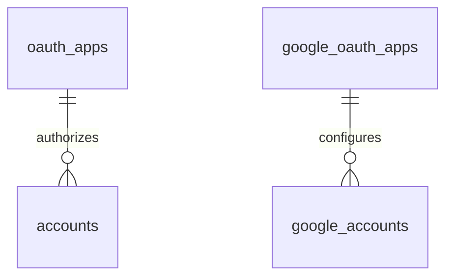

# Credential Data Model

TL;DR: Credential tables store Yandex OAuth apps and accounts plus Google OAuth apps and accounts. Secret and token columns are encrypted blobs; workspace repositories decrypt them only when building internal account objects (`packages/core/src/db/migrations.ts:3-25`, `packages/core/src/db/migrations.ts:145-170`, `packages/yandex-seo/src/lib/db/accounts-repo.ts:1-4`).

## Tables

### `oauth_apps`

Stores Yandex OAuth client configuration. It has a unique label and stores the client secret as an encrypted BLOB (`packages/core/src/db/migrations.ts:4-11`).

| Field | Meaning | Evidence |
|---|---|---|
| `id` | Integer row identity, generated by SQLite | `packages/core/src/db/migrations.ts:5-5` |
| `label` | User-facing unique app label | `packages/core/src/db/migrations.ts:6-6` |
| `client_id` | OAuth application identifier from provider configuration | `packages/core/src/db/migrations.ts:7-7` |
| `client_secret_enc` | Authenticated encrypted client secret bytes | `packages/core/src/db/migrations.ts:8-8`, `packages/core/src/crypto/secret-cipher.ts:10-17` |
| `scopes_declared` | Space-separated scope declarations persisted by the workspace | `packages/core/src/db/migrations.ts:9-9` |
| `created_at` | Unix timestamp in seconds | `packages/core/src/db/migrations.ts:10-10`, `packages/yandex-seo/src/lib/db/oauth-apps-repo.ts:44-45` |

### `accounts`

Stores connected Yandex identities, account tokens, scopes, and a default-account flag. Each row references an OAuth app, and deleting the app is restricted while an account references it (`packages/core/src/db/migrations.ts:12-25`).

| Field | Meaning | Evidence |
|---|---|---|
| `id` | Integer row identity | `packages/core/src/db/migrations.ts:13-13` |
| `label` | Unique local account label | `packages/core/src/db/migrations.ts:14-14` |
| `oauth_app_id` | Parent OAuth app; FK delete behavior is RESTRICT | `packages/core/src/db/migrations.ts:15-15` |
| `yandex_login` | Provider login when supplied | `packages/core/src/db/migrations.ts:16-16` |
| `webmaster_user_id` | Yandex Webmaster user identifier when supplied | `packages/core/src/db/migrations.ts:17-17` |
| `access_token_enc`, `refresh_token_enc` | Encrypted OAuth token bytes | `packages/core/src/db/migrations.ts:18-19`, `packages/core/src/crypto/secret-cipher.ts:10-17` |
| `expires_at` | Access-token expiration as Unix seconds | `packages/core/src/db/migrations.ts:20-20`, `packages/yandex-seo/src/lib/db/accounts-repo.ts:100-104` |
| `scopes_granted` | Space-separated scopes granted by provider | `packages/core/src/db/migrations.ts:21-21` |
| `is_default` | Integer boolean flag; `1` marks the default account | `packages/core/src/db/migrations.ts:22-22`, `packages/core/src/db/migrations.ts:26-26` |
| `created_at`, `updated_at` | Unix timestamps in seconds | `packages/core/src/db/migrations.ts:23-24`, `packages/yandex-seo/src/lib/db/accounts-repo.ts:100-104` |

### `google_oauth_apps`

Stores Google OAuth client configuration, including required callback redirect URI (`packages/core/src/db/migrations.ts:145-153`).

| Field | Meaning | Evidence |
|---|---|---|
| `id` | Integer row identity | `packages/core/src/db/migrations.ts:146-146` |
| `label` | Unique local OAuth app label | `packages/core/src/db/migrations.ts:147-147` |
| `client_id` | Google OAuth client ID | `packages/core/src/db/migrations.ts:148-148` |
| `client_secret_enc` | Encrypted secret bytes | `packages/core/src/db/migrations.ts:149-149`, `packages/google-search-console/src/lib/db/oauth-apps-repo.ts:57-84` |
| `scopes_declared` | Declared OAuth scopes | `packages/core/src/db/migrations.ts:150-150` |
| `redirect_uri` | OAuth callback URI used by the app | `packages/core/src/db/migrations.ts:151-151` |
| `created_at` | Unix timestamp in seconds | `packages/core/src/db/migrations.ts:152-152`, `packages/google-search-console/src/lib/db/oauth-apps-repo.ts:68-69` |

### `google_accounts`

Stores OAuth-user or service-account credentials for Google workspaces. `auth_method` is constrained to two values; OAuth app linkage is optional (`packages/core/src/db/migrations.ts:155-170`).

| Field | Meaning | Evidence |
|---|---|---|
| `id`, `label` | Generated integer row identity and unique local label | `packages/core/src/db/migrations.ts:156-157` |
| `auth_method` | `oauth_user` or `service_account`, selected on account creation | `packages/core/src/db/migrations.ts:158-158`, `packages/gtm/src/lib/db/accounts-repo.ts:124-147` |
| `oauth_app_id` | Optional linked Google OAuth app; FK delete behavior is RESTRICT | `packages/core/src/db/migrations.ts:159-159` |
| `google_email`, `google_project_id` | Provider identity and project fields when present | `packages/core/src/db/migrations.ts:160-161` |
| `access_token_enc`, `refresh_token_enc` | Encrypted OAuth-user token blobs; nullable for service accounts | `packages/core/src/db/migrations.ts:162-163` |
| `service_account_json_enc` | Encrypted service-account JSON; nullable for OAuth users | `packages/core/src/db/migrations.ts:164-164` |
| `expires_at` | Access token expiration in Unix seconds; defaults to zero | `packages/core/src/db/migrations.ts:165-165`, `packages/core/src/google-oauth/token-broker.ts:31-35` |
| `scopes_granted` | Space-separated granted scopes | `packages/core/src/db/migrations.ts:166-166` |
| `is_default` | Integer boolean default-account marker | `packages/core/src/db/migrations.ts:167-167`, `packages/core/src/db/migrations.ts:171-172` |
| `created_at`, `updated_at` | Unix timestamps in seconds | `packages/core/src/db/migrations.ts:168-169`, `packages/gtm/src/lib/db/accounts-repo.ts:132-146` |

## Relationships

The Google account app reference is nullable. Both app-to-account FKs restrict deletion; workspace repositories also check for attached accounts before deleting a Google OAuth app (`packages/core/src/db/migrations.ts:15-15`, `packages/core/src/db/migrations.ts:159-159`, `packages/google-search-console/src/lib/db/oauth-apps-repo.ts:118-142`).

## Status and lifecycle transitions

| Field | From | To | Function and when |
|---|---|---|---|
| `accounts.is_default` | `0` or another account at `1` | Selected account `1`, prior default(s) `0` | Yandex workspace default selection updates all defaults in a transaction (`packages/yandex-seo/src/lib/db/accounts-repo.ts:218-236`). |
| `google_accounts.is_default` | `0` or another account at `1` | Selected account `1`, prior default(s) `0` | Google workspace `setDefaultAccount` clears current marker and sets the requested row in a transaction (`packages/gtm/src/lib/db/accounts-repo.ts:230-241`). |
| `google_accounts.auth_method` | Not present | `oauth_user` or `service_account` | Inserted once from caller input; no update transition is present in the inspected repository (`packages/core/src/db/migrations.ts:158-158`, `packages/gtm/src/lib/db/accounts-repo.ts:124-147`). |

## Invariants

- App and account labels are unique within each table (`packages/core/src/db/migrations.ts:6-6`, `packages/core/src/db/migrations.ts:14-14`, `packages/core/src/db/migrations.ts:147-147`, `packages/core/src/db/migrations.ts:157-157`).
- Google `auth_method` accepts only `oauth_user` and `service_account` (`packages/core/src/db/migrations.ts:158-158`).
- The schema does not enforce exactly one default account; repositories clear current defaults before setting the requested row (`packages/core/src/db/migrations.ts:22-22`, `packages/core/src/db/migrations.ts:167-172`, `packages/gtm/src/lib/db/accounts-repo.ts:230-241`).
- App deletion is blocked while dependent accounts exist (`packages/core/src/db/migrations.ts:15-15`, `packages/core/src/db/migrations.ts:159-159`).

## Writers and readers

| Use case | Tables | Code owner |
|---|---|---|
| Yandex OAuth app/account management | `oauth_apps`, `accounts` | `yandex-seo` repositories encrypt/decrypt client secrets and tokens; account storage uses the same core cipher (`packages/yandex-seo/src/lib/db/oauth-apps-repo.ts:1-4`, `packages/yandex-seo/src/lib/db/accounts-repo.ts:1-4`). |
| Google OAuth app/account management | `google_oauth_apps`, `google_accounts` | GSC, GA4, GTM, and Ads workspace repositories use the shared schema and core cipher; the GSC repository demonstrates app CRUD (`packages/google-search-console/src/lib/db/oauth-apps-repo.ts:1-4`, `packages/gtm/src/lib/db/accounts-repo.ts:120-147`). |
| OAuth token use | `accounts`, `google_accounts` | Workspaces decrypt database values before passing them to provider clients or the core Google token broker (`packages/core/src/google-oauth/token-broker.ts:23-41`). |

## Retention and cleanup

Core defines no credential cleanup job. Account and app rows are removed by workspace delete operations; FK constraints restrict deleting an app that still has accounts (`packages/core/src/db/migrations.ts:15-15`, `packages/core/src/db/migrations.ts:159-159`).

<!-- lane-pilot:backlinks -->
## Referenced by

- [Core Data Model](../data-model.md)
- [Google OAuth and Token Broker](../features/google-oauth.md)
- [Secret Encryption and Package Configuration](../features/secrets-and-package-config.md)
