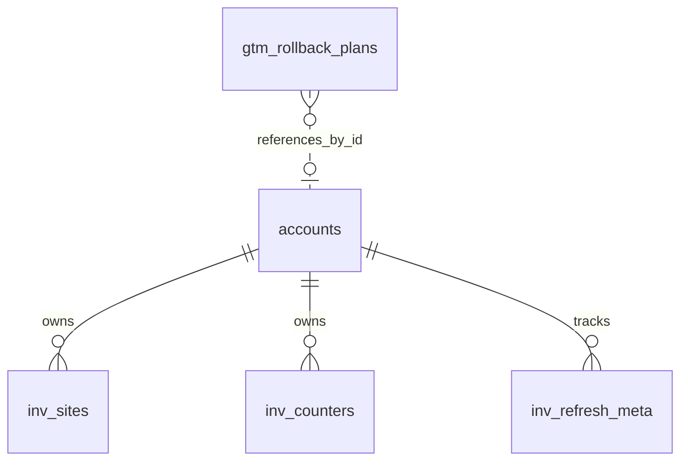

# Inventory and Rollback Data Model

TL;DR: Yandex inventory tables hold per-account site/counter snapshots and refresh metadata. GTM rollback plans hold expiring confirmation data and are consumed atomically when the rollback confirmation runs (`packages/core/src/db/migrations.ts:29-67`, `packages/core/src/db/migrations.ts:175-190`).

## Tables

### `inv_sites`

Stores the latest known Yandex Webmaster site records for each Yandex account. Refresh uses `(account_id, host_id)` as the upsert identity and removes rows missing from the newest result (`packages/core/src/db/migrations.ts:30-43`, `packages/yandex-seo/src/lib/db/inventory-repo.ts:74-103`).

| Field | Meaning | Evidence |
|---|---|---|
| `id` | Generated integer row identity | `packages/core/src/db/migrations.ts:31-31` |
| `account_id` | Owning Yandex account; cascade delete on account removal | `packages/core/src/db/migrations.ts:32-32` |
| `host_id` | Provider site identifier within the account | `packages/core/src/db/migrations.ts:33-33` |
| `ascii_host_url`, `unicode_host_url` | ASCII and optional Unicode host forms | `packages/core/src/db/migrations.ts:34-35` |
| `verified`, `main_mirror` | Integer flags supplied by the provider response | `packages/core/src/db/migrations.ts:36-37`, `packages/yandex-seo/src/lib/db/inventory-repo.ts:92-95` |
| `indexed_pages` | Optional indexed-page count | `packages/core/src/db/migrations.ts:38-38` |
| `fetched_at` | Snapshot fetch time in Unix seconds | `packages/core/src/db/migrations.ts:39-39`, `packages/yandex-seo/src/lib/db/inventory-repo.ts:75-76` |

### `inv_counters`

Stores the latest Yandex Metrika counter snapshot per account (`packages/core/src/db/migrations.ts:45-57`).

| Field | Meaning | Evidence |
|---|---|---|
| `id` | Generated integer row identity | `packages/core/src/db/migrations.ts:46-46` |
| `account_id` | Owning Yandex account; cascade delete on account removal | `packages/core/src/db/migrations.ts:47-47` |
| `counter_id` | Provider counter ID represented as text | `packages/core/src/db/migrations.ts:48-48` |
| `name`, `site` | Optional counter name and associated site | `packages/core/src/db/migrations.ts:49-50` |
| `status`, `permission` | Provider status and permission strings; values come from API results | `packages/core/src/db/migrations.ts:51-52`, `packages/yandex-seo/src/lib/db/inventory-repo.ts:139-140` |
| `fetched_at` | Snapshot fetch time in Unix seconds | `packages/core/src/db/migrations.ts:53-53`, `packages/yandex-seo/src/lib/db/inventory-repo.ts:123-123` |

### `inv_refresh_meta`

Tracks the last attempt, last successful refresh, and last error for each account and inventory kind (`packages/core/src/db/migrations.ts:59-66`).

| Field | Meaning | Evidence |
|---|---|---|
| `account_id` | Owning Yandex account; cascade delete | `packages/core/src/db/migrations.ts:60-60` |
| `kind` | Exactly `sites` or `counters` | `packages/core/src/db/migrations.ts:61-61` |
| `last_refresh_success_at`, `last_refresh_attempt_at` | Optional Unix seconds for successful refresh and latest attempt | `packages/core/src/db/migrations.ts:62-63`, `packages/yandex-seo/src/lib/db/inventory-repo.ts:159-177` |
| `last_error` | Optional error text from most recent failed attempt | `packages/core/src/db/migrations.ts:64-64`, `packages/yandex-seo/src/lib/db/inventory-repo.ts:170-177` |

### `gtm_rollback_plans`

Stores a rollback preview until it expires or a confirmation claims it (`packages/core/src/db/migrations.ts:177-190`).

| Field | Meaning | Evidence |
|---|---|---|
| `id` | Random plan identifier and primary key | `packages/core/src/db/migrations.ts:178-178`, `packages/gtm/src/tools/gtm-rollback.ts:71-72` |
| `account_id` | Local Google account ID; no FK declared | `packages/core/src/db/migrations.ts:179-179` |
| `gtm_account_id`, `container_id`, `workspace_id` | GTM resource identifiers required to replay the preview | `packages/core/src/db/migrations.ts:180-182`, `packages/gtm/src/tools/gtm-rollback.ts:121-124` |
| `from_version_id`, `to_version_id` | Version being rolled back from and target version | `packages/core/src/db/migrations.ts:183-184` |
| `fingerprint` | Preview fingerprint used by rollback verification | `packages/core/src/db/migrations.ts:185-185` |
| `expires_at`, `created_at` | Unix seconds for expiry and creation | `packages/core/src/db/migrations.ts:186-187`, `packages/gtm/src/tools/gtm-rollback.ts:71-84` |

## Relationships

The first three relationships have cascading foreign keys. The rollback table's `account_id` is a plain integer with no declared relation (`packages/core/src/db/migrations.ts:30-32`, `packages/core/src/db/migrations.ts:45-47`, `packages/core/src/db/migrations.ts:59-60`, `packages/core/src/db/migrations.ts:177-190`).

## Status and lifecycle transitions

| Field | From | To | Function and when |
|---|---|---|---|
| `inv_refresh_meta.last_error` | Prior value or null | Error text plus updated attempt timestamp | `setRefreshMetaError` after refresh failure (`packages/yandex-seo/src/lib/db/inventory-repo.ts:170-177`). |
| `inv_refresh_meta.last_error` | Prior error or null | Null plus success and attempt timestamps | `setRefreshMetaSuccess` after a successful refresh (`packages/yandex-seo/src/lib/db/inventory-repo.ts:159-168`). |
| Inventory snapshot rows | Existing account snapshot | Incoming rows upserted and absent IDs deleted | `upsertSitesForAccount` / `upsertCountersForAccount` in a transaction (`packages/yandex-seo/src/lib/db/inventory-repo.ts:74-103`, `packages/yandex-seo/src/lib/db/inventory-repo.ts:121-149`). |
| Rollback plan | Absent | Inserted with expiry | GTM rollback preview (`packages/gtm/src/tools/gtm-rollback.ts:71-84`). |
| Rollback plan | Present and unexpired | Deleted and returned to the confirmation call | Confirmation atomically deletes with `RETURNING`; missing/expired plan throws (`packages/gtm/src/tools/gtm-rollback.ts:107-117`). |

## Invariants

- Site and counter records are unique per account and provider ID (`packages/core/src/db/migrations.ts:40-40`, `packages/core/src/db/migrations.ts:54-54`).
- `inv_refresh_meta` is unique per account and one of two constrained kinds (`packages/core/src/db/migrations.ts:61-65`).
- Inventory replacement is transactional and removes stale records for the refreshed account (`packages/yandex-seo/src/lib/db/inventory-repo.ts:77-103`, `packages/yandex-seo/src/lib/db/inventory-repo.ts:124-149`).
- Rollback confirmation consumes the plan before later checks and provider calls; a mismatch or downstream failure does not restore the row (`packages/gtm/src/tools/gtm-rollback.ts:107-124`).

## Writers and readers

Yandex SEO's inventory repository upserts and lists sites/counters, and records refresh success or failure. GTM's rollback tool inserts preview plans and deletes them on confirmation (`packages/yandex-seo/src/lib/db/inventory-repo.ts:74-177`, `packages/gtm/src/tools/gtm-rollback.ts:71-117`).

## Retention and cleanup

Removing a Yandex account cascades to its inventory and refresh metadata (`packages/core/src/db/migrations.ts:32-32`, `packages/core/src/db/migrations.ts:47-47`, `packages/core/src/db/migrations.ts:60-60`). Core defines no scheduled removal for old metadata. Rollback plans have an expiry index; confirmation deletes the selected plan, but schema migration contains no periodic expiry purge (`packages/core/src/db/migrations.ts:189-190`, `packages/gtm/src/tools/gtm-rollback.ts:107-117`).

<!-- lane-pilot:backlinks -->
## Referenced by

- [Core Data Model](../data-model.md)
