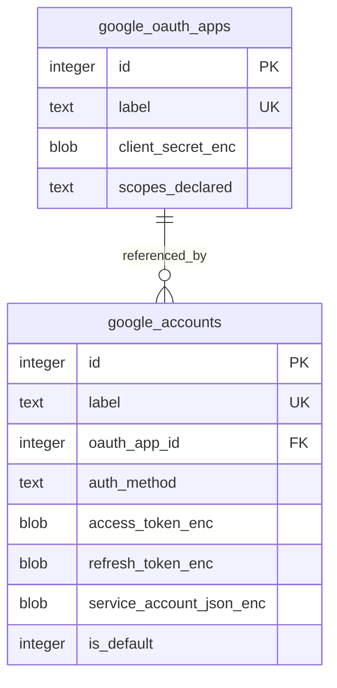

# GA4 data model overview

TL;DR: GA4 account setup persists OAuth app and Google account records in the package SQLite database; shared core migrations define the tables and GA4 repositories define read/write behavior (packages/core/src/db/migrations.ts:143-173, packages/ga4/src/lib/db/accounts-repo.ts:88-245).

## Schema overview

The app reference is optional for service-account records; the foreign key prevents deleting a referenced app (packages/core/src/db/migrations.ts:145-169, packages/ga4/src/lib/db/oauth-apps-repo.ts:130-142). Fields and lifecycle are documented in [Google credential records](data-model/google-credentials.md).

## Domain areas

- [Google credential records](data-model/google-credentials.md): OAuth app setup, OAuth-user accounts, and service accounts.

## Ownership

MCP core creates the tables and configures SQLite; GA4 repositories implement package-specific persistence and projections (packages/core/src/db/migrations.ts:143-173, packages/core/src/db/connection.ts:33-61, packages/ga4/src/lib/db/accounts-repo.ts:88-245, packages/ga4/src/lib/db/oauth-apps-repo.ts:46-143).

<!-- lane-pilot:backlinks -->
## Referenced by

- [Google Analytics 4 workspace overview](overview.md)
