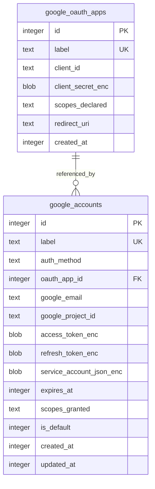

# Google credential records

TL;DR: google_oauth_apps stores OAuth client configuration; google_accounts stores user OAuth or service-account credentials, scopes, and default-account selection (packages/core/src/db/migrations.ts:145-172).

## Tables and relationships

## google_oauth_apps

Purpose: retain OAuth client configuration. Labels are unique and client_secret_enc stores an encrypted secret (packages/core/src/db/migrations.ts:145-153, packages/ga4/src/lib/db/oauth-apps-repo.ts:57-84).

| Field | Meaning |
|---|---|
| id | Local SQLite primary key referenced by OAuth-user accounts. |
| label | Unique operator-selected key used for registration, flow lookup, and deletion. |
| client_id | Google OAuth client identifier. |
| client_secret_enc | Encrypted client secret, decrypted only by full-row lookup. |
| scopes_declared | Space-delimited OAuth scopes requested by the loopback flow. |
| redirect_uri | Registered redirect URI retained with app record. |
| created_at | Unix seconds when inserted. |

Public app rows omit the secret; deletion checks for attached accounts (packages/ga4/src/lib/db/oauth-apps-repo.ts:28-44, packages/ga4/src/lib/db/oauth-apps-repo.ts:118-142).

## google_accounts

Purpose: retain credentials and selection metadata for a Google identity or service account (packages/core/src/db/migrations.ts:155-170).

| Field | Meaning |
|---|---|
| id | Local SQLite primary key. |
| label | Unique local key supplied as account to GA4 tools. |
| auth_method | oauth_user for browser OAuth; service_account for a service-account key. Database CHECK restricts values. |
| oauth_app_id | OAuth app reference; null for service accounts; deletion is restricted while referenced. |
| google_email | Email from userinfo or service-account client_email. |
| google_project_id | Service-account project identifier; null when absent. |
| access_token_enc | Encrypted short-lived access token. |
| refresh_token_enc | Encrypted OAuth refresh token; optional. |
| service_account_json_enc | Encrypted source JSON key; populated by service-account registration. |
| expires_at | Access-token expiry in Unix seconds; token refresh updates it. |
| scopes_granted | Space-delimited scopes returned by OAuth or requested for service-account registration. |
| is_default | 1 selects the default account; 0 means not default. |
| created_at | Unix seconds when inserted. |
| updated_at | Unix seconds when credentials are inserted or tokens refreshed. |

Repository conversion decrypts secret fields for internal callers; list projection returns non-secret metadata (packages/ga4/src/lib/db/accounts-repo.ts:38-79, packages/ga4/src/lib/db/accounts-repo.ts:88-98).

## Lifecycle

| Field | From | To | Function and condition |
|---|---|---|---|
| auth_method | absent | oauth_user | runStartGoogleOauthFlow inserts after token exchange (packages/ga4/src/tools/start-google-oauth-flow.ts:72-82). |
| auth_method | absent | service_account | runRegisterServiceAccount inserts only after successful JWT exchange (packages/ga4/src/tools/register-google-service-account.ts:28-52). |
| is_default | 0 | 1 | setDefaultAccount clears existing default and sets selected account transactionally (packages/ga4/src/lib/db/accounts-repo.ts:230-241). |
| is_default | 1 | 0 | setDefaultAccount clears previous default when another account is selected (packages/ga4/src/lib/db/accounts-repo.ts:232-240). |
| credentials and row | present | absent | deleteAccount removes account; deleteOAuthApp removes an unreferenced app (packages/ga4/src/lib/db/accounts-repo.ts:243-246, packages/ga4/src/lib/db/oauth-apps-repo.ts:118-142). |
| token values | old token/expiry | new access token/expiry | updateAccountTokens encrypts token and updates expiry/timestamp (packages/ga4/src/lib/db/accounts-repo.ts:164-194). |

## Invariants

- App/account labels are unique; auth_method is limited to oauth_user or service_account (packages/core/src/db/migrations.ts:145-158).
- oauth_app_id uses ON DELETE RESTRICT; the repository also checks for attached accounts (packages/core/src/db/migrations.ts:155-160, packages/ga4/src/lib/db/oauth-apps-repo.ts:130-142).
- The partial default index covers rows where is_default=1; the repository selects one row with LIMIT 1 (packages/core/src/db/migrations.ts:171-172, packages/ga4/src/lib/db/accounts-repo.ts:220-240).
- Credential secrets are encrypted before storage and omitted from public list projections (packages/ga4/src/lib/db/accounts-repo.ts:55-79, packages/ga4/src/lib/db/oauth-apps-repo.ts:28-43).

## Writers, readers, retention

| Use case | Writer | Reader |
|---|---|---|
| Register OAuth client | registerGoogleOauthApp → insertOAuthApp (packages/ga4/src/tools/register-google-oauth-app.ts:25-31) | OAuth flow and listing (packages/ga4/src/tools/start-google-oauth-flow.ts:19-21, packages/ga4/src/lib/db/oauth-apps-repo.ts:46-55) |
| Connect Google user | startGoogleOauthFlow → insertAccount (packages/ga4/src/tools/start-google-oauth-flow.ts:58-82) | Account selection/API token use (packages/ga4/src/lib/account-resolver.ts:35-55, packages/ga4/src/lib/ga4-client.ts:57-77) |
| Register service account | runRegisterServiceAccount → insertAccount (packages/ga4/src/tools/register-google-service-account.ts:42-52) | Account selection/API token use (packages/ga4/src/lib/account-resolver.ts:35-55, packages/ga4/src/lib/ga4-client.ts:57-77) |
| Remove credentials | deleteGoogleAccount / deleteGoogleOauthApp (packages/ga4/src/tools/delete-google-account.ts:6-17, packages/ga4/src/tools/delete-google-oauth-app.ts:6-38) | Subsequent listing and resolution queries no longer return deleted rows (packages/ga4/src/lib/db/accounts-repo.ts:88-98, packages/ga4/src/lib/db/accounts-repo.ts:196-227) |

The workspace defines no retention or cleanup job for credentials; removal is explicit through account/app commands (packages/ga4/src/index.ts:124-177).

<!-- lane-pilot:backlinks -->
## Referenced by

- [GA4 data model overview](../data-model.md)
- [Google account and OAuth management](../features/accounts-and-oauth.md)
