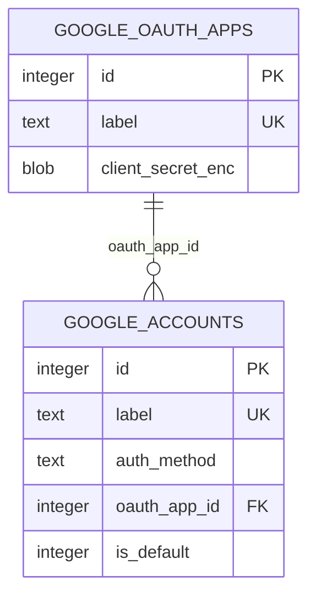

# Google Ads Data Model

**TL;DR:** Google Ads persists two credential entities in the shared SQLite database: OAuth app definitions and connected Google Ads accounts.

## Schema overview

The core migration defines both tables and the foreign key from user accounts to OAuth apps (`packages/core/src/db/migrations.ts:143-173`). Their detailed fields, transitions, and readers/writers are in [account credentials](data-model/account-credentials.md).

## Ownership

`@ohmy-seo/mcp-core` owns database creation and the table definitions; `@ohmy-seo/google-ads` owns the repository behavior and use cases for these records (`packages/core/src/db/migrations.ts:143-173`, `packages/google-ads/src/lib/db/accounts-repo.ts:88-100`, `packages/google-ads/src/lib/db/oauth-apps-repo.ts:46-57`).

## Related pages

- [Account credentials](data-model/account-credentials.md) — field meanings, default-account transition, lifecycle, and use cases.
- [Account access](features/account-access.md) — the MCP operations that create, select, and delete these records.

<!-- lane-pilot:backlinks -->
## Referenced by

- [Google Ads Account Access](features/account-access.md)
- [Google Ads Workspace — Overview](overview.md)
