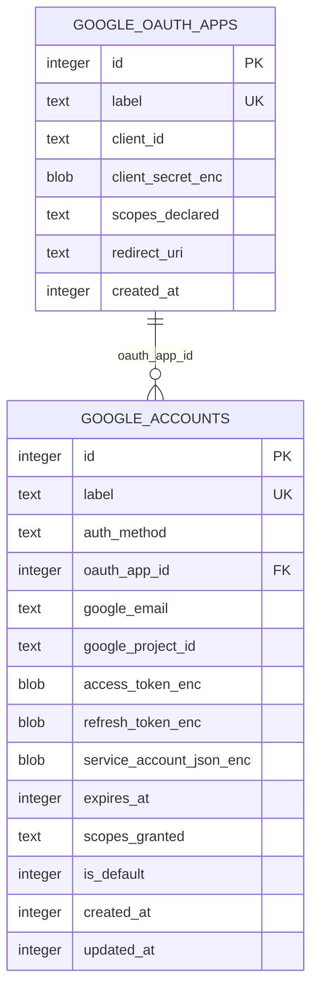

# Google Ads Account Credentials

**TL;DR:** The credential domain stores OAuth client registrations and named user or service accounts; secrets are encrypted at rest and removed through account and app management tools.

## Entities

The entities and SQL constraints come from the core migration (`packages/core/src/db/migrations.ts:143-173`).

## Tables

### `google_oauth_apps`

Stores client registrations used to build user OAuth authorization links and exchange authorization codes. Client secret is stored as an encrypted BLOB and returned only to internal code after decryption (`packages/google-ads/src/lib/db/oauth-apps-repo.ts:28-44`, `packages/google-ads/src/lib/db/oauth-apps-repo.ts:57-101`).

| Field | Meaning |
|---|---|
| `id` | Generated integer primary key. |
| `label` | Unique operator-provided name used by OAuth app management tools. |
| `client_id` | Google OAuth client identifier supplied at registration. |
| `client_secret_enc` | Encrypted OAuth client secret; encrypted by `encryptSecret` before insert. |
| `scopes_declared` | Space-delimited OAuth scopes requested for new user authorization. |
| `redirect_uri` | Registered redirect URI associated with the app; the runtime flow uses the callback URL returned by its loopback listener. |
| `created_at` | Unix timestamp in whole seconds, assigned at insert. |

All columns are declared in the migration (`packages/core/src/db/migrations.ts:145-153`); insertion sets `created_at` with `Math.floor(Date.now()/1000)` and encrypts the supplied plaintext secret (`packages/google-ads/src/lib/db/oauth-apps-repo.ts:67-84`).

### `google_accounts`

Stores a named credential profile used for Ads API requests. The `oauth_app_id` foreign key is restricted from deletion while referenced (`packages/core/src/db/migrations.ts:155-172`).

| Field | Meaning |
|---|---|
| `id` | Generated integer primary key. |
| `label` | Unique operator-provided selector accepted as `account` by Ads tools. |
| `auth_method` | `oauth_user` for a user OAuth account or `service_account` for a JSON service-account key. The database CHECK constraint limits values to these two strings. |
| `oauth_app_id` | OAuth app row used by user OAuth; nullable for service accounts. Foreign key uses `ON DELETE RESTRICT`. |
| `google_email` | Google profile email for user OAuth or service-account client email. |
| `google_project_id` | Service-account Cloud project ID; null for user OAuth. |
| `access_token_enc` | Encrypted access token, stored from successful OAuth or service-account token exchange. |
| `refresh_token_enc` | Encrypted refresh token for user OAuth when Google returns one; nullable. |
| `service_account_json_enc` | Encrypted JSON key for service-account authentication; null for user OAuth. |
| `expires_at` | Unix timestamp in whole seconds for access token expiry. |
| `scopes_granted` | Space-delimited granted/requested scopes used to check Ads API permission before calls. |
| `is_default` | Integer flag, `0` or `1`; tools without an explicit account resolve the row marked `1`. |
| `created_at`, `updated_at` | Unix timestamps in whole seconds; both are set on insert, while token refresh updates `updated_at`. |

The stored columns and constraints are defined by the migration (`packages/core/src/db/migrations.ts:155-172`). Account insertion encrypts token/key plaintext and initializes both timestamps (`packages/google-ads/src/lib/db/accounts-repo.ts:100-161`); token refresh updates encrypted token values, expiry, and update time (`packages/google-ads/src/lib/db/accounts-repo.ts:164-194`).

## Lifecycle transitions

`auth_method` is fixed at insert and constrained to the two authentication modes. Account token refresh changes token fields and expiry, not `auth_method` (`packages/core/src/db/migrations.ts:155-169`, `packages/google-ads/src/lib/db/accounts-repo.ts:164-194`).

| Field | From | To | Function | When |
|---|---|---|---|---|
| `is_default` | `0` or no default row | `1` for selected account; all existing default rows become `0` | `setDefaultAccount` (`packages/google-ads/src/lib/db/accounts-repo.ts:230-240`) | `set_default_google_account` selects an existing label (`packages/google-ads/src/tools/set-default-google-account.ts:6-22`). |
| `is_default` | `1` | Account row removed; the field no longer exists | `deleteAccount` removes the row (`packages/google-ads/src/lib/db/accounts-repo.ts:243-246`) | `delete_google_account` deletes the selected account (`packages/google-ads/src/tools/delete-google-account.ts:6-22`). |
| `google_accounts` row | absent | present | `insertAccount` (`packages/google-ads/src/lib/db/accounts-repo.ts:100-161`) | OAuth callback succeeds or service-account verification succeeds (`packages/google-ads/src/tools/start-google-oauth-flow.ts:58-82`, `packages/google-ads/src/tools/register-google-service-account.ts:25-52`). |
| `google_accounts` row | present | absent | `deleteAccount` (`packages/google-ads/src/lib/db/accounts-repo.ts:243-246`) | Account deletion tool resolves the label and removes the row (`packages/google-ads/src/tools/delete-google-account.ts:6-22`). |
| `google_oauth_apps` row | absent | present | `insertOAuthApp` (`packages/google-ads/src/lib/db/oauth-apps-repo.ts:57-101`) | OAuth app is registered. |
| `google_oauth_apps` row | present and unreferenced | absent | `deleteOAuthApp` (`packages/google-ads/src/lib/db/oauth-apps-repo.ts:118-143`) | App deletion passes its transaction check; attached accounts cause an error instead. |

## Invariants

- App labels and account labels are unique (`packages/core/src/db/migrations.ts:145-160`).
- `google_accounts.auth_method` is restricted to `oauth_user` and `service_account` (`packages/core/src/db/migrations.ts:155-160`).
- OAuth app deletion is rejected when any account references its ID (`packages/google-ads/src/lib/db/oauth-apps-repo.ts:118-143`).
- Public account and OAuth app projections omit encrypted credentials; only internal full-row lookups decrypt secrets (`packages/google-ads/src/lib/db/accounts-repo.ts:24-87`, `packages/google-ads/src/lib/db/oauth-apps-repo.ts:16-44`).
- The account resolver selects by label or `is_default`, then checks required scope membership (`packages/google-ads/src/lib/account-resolver.ts:30-58`).

## Writers, readers, and retention

| Use case | Writer or reader |
|---|---|
| Register/list/delete OAuth app | `insertOAuthApp`, `listOAuthApps`, and `deleteOAuthApp` in `packages/google-ads/src/lib/db/oauth-apps-repo.ts:46-143`. |
| Connect/delete/default account | `insertAccount`, `deleteAccount`, and `setDefaultAccount` in `packages/google-ads/src/lib/db/accounts-repo.ts:100-161`, `packages/google-ads/src/lib/db/accounts-repo.ts:230-246`. |
| Resolve Ads credentials | `findAccountByLabel` or `getDefaultAccount` in `packages/google-ads/src/lib/db/accounts-repo.ts:196-228`; `findOAuthAppById` in `packages/google-ads/src/lib/ads-client.ts:414-426` retrieves OAuth client credentials for token acquisition. |
| Show management lists | `listAccounts` and `listOAuthApps` expose public projections without tokens or secrets (`packages/google-ads/src/lib/db/accounts-repo.ts:88-98`, `packages/google-ads/src/lib/db/oauth-apps-repo.ts:46-55`). |

These credential rows have no retention or scheduled cleanup path in the workspace; explicit account and OAuth app deletion are the cleanup paths (`packages/google-ads/src/lib/db/accounts-repo.ts:243-246`, `packages/google-ads/src/lib/db/oauth-apps-repo.ts:118-143`).

<!-- lane-pilot:backlinks -->
## Referenced by

- [Google Ads Data Model](../data-model.md)
