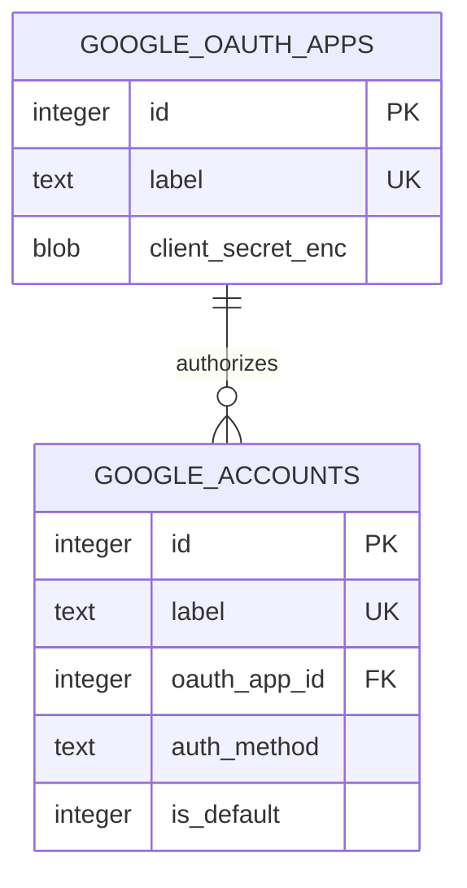

# Google Search Console data model

TL;DR: The workspace persists OAuth client apps and Google accounts in SQLite tables created by the shared core migration; account rows can reference the OAuth app used to authorize them (`packages/core/src/db/migrations.ts:145-173`).

## Schema overview

The relation is optional for service accounts, and SQLite restricts deleting an OAuth app while an account references it (`packages/core/src/db/migrations.ts:145-169`).

Domain fields and their meaning are detailed in [OAuth credentials and accounts](data-model/oauth-credentials.md). The package also uses the shared query cache, but the cache schema and lifecycle belong to `@ohmy-seo/mcp-core`; this workspace does not define that domain table (`packages/google-search-console/src/tools/gsc-search-analytics.ts:71-78`, `packages/core/src/db/migrations.ts:95-139`).

## Ownership

| Data | Meaning | Owning workspace | Evidence |
|---|---|---|---|
| OAuth apps and Google accounts | OAuth app labels and account labels are unique; account `auth_method` is `oauth_user` or `service_account`; `is_default` is `1` for the selected default and `0` otherwise. `created_at`, `updated_at`, and `expires_at` use Unix seconds. | `@ohmy-seo/google-search-console` repositories; shared table creation in `@ohmy-seo/mcp-core` | `packages/core/src/db/migrations.ts:145-173`, `packages/google-search-console/src/lib/db/accounts-repo.ts:115-116`, `packages/google-search-console/src/lib/db/accounts-repo.ts:230-241` |
| Query cache entries | Shared cache keyed by tool, account, and arguments; GSC read cache TTLs are configured in seconds. | `@ohmy-seo/mcp-core`; GSC tools call its cache interface | `packages/google-search-console/src/tools/gsc-search-analytics.ts:71-78`, `packages/core/src/db/migrations.ts:95-139` |

## Related pages

- [OAuth credentials and accounts](data-model/oauth-credentials.md) — field meaning, account state transitions, use cases, and retention.
- [Account and OAuth management](features/accounts-and-oauth.md) — tool behavior that creates and removes these records.

<!-- lane-pilot:backlinks -->
## Referenced by

- [Google account and OAuth management](features/accounts-and-oauth.md)
- [Google Search Console workspace overview](overview.md)
