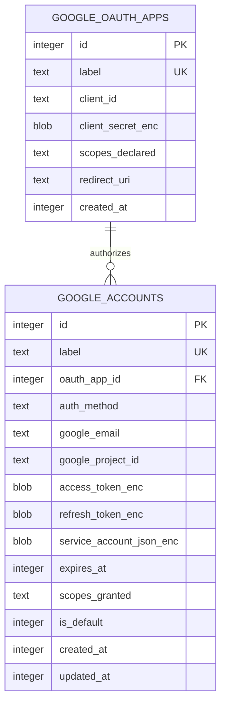

# OAuth credentials and Google accounts

TL;DR: `google_oauth_apps` stores OAuth client metadata and an encrypted secret; `google_accounts` stores user or service-account identity, encrypted credentials, granted scopes, expiry, and the selected default flag (`packages/core/src/db/migrations.ts:145-172`).

## Entity relationship

The optional account-to-app foreign key uses `ON DELETE RESTRICT`. App labels and account labels are unique independently (`packages/core/src/db/migrations.ts:145-169`).

## `google_oauth_apps`

Purpose: preserve client configuration needed to start OAuth authorization and exchange its returned code. The full client secret is encrypted on insert and decrypted only by internal full-row lookup (`packages/google-search-console/src/lib/db/oauth-apps-repo.ts:39-44`, `packages/google-search-console/src/lib/db/oauth-apps-repo.ts:57-101`).

| Field | Meaning | Evidence |
|---|---|---|
| `id` | SQLite-generated identifier; referenced by OAuth user accounts | `packages/core/src/db/migrations.ts:146-146` |
| `label` | Unique local name used by tools to select the app | `packages/core/src/db/migrations.ts:147-147`, `packages/google-search-console/src/tools/start-google-oauth-flow.ts:19-21` |
| `client_id` | Public Google OAuth client identifier | `packages/core/src/db/migrations.ts:148-148` |
| `client_secret_enc` | AES-encrypted client secret bytes | `packages/core/src/db/migrations.ts:149-149`, `packages/google-search-console/src/lib/db/oauth-apps-repo.ts:67-70` |
| `scopes_declared` | Space-delimited scopes placed in the authorization request | `packages/core/src/db/migrations.ts:150-150`, `packages/google-search-console/src/tools/start-google-oauth-flow.ts:37-42` |
| `redirect_uri` | Redirect URI provided at registration; the flow uses the active loopback listener's callback URL | `packages/core/src/db/migrations.ts:151-151`, `packages/google-search-console/src/tools/start-google-oauth-flow.ts:34-42` |
| `created_at` | Creation time as Unix seconds | `packages/core/src/db/migrations.ts:152-152`, `packages/google-search-console/src/lib/db/oauth-apps-repo.ts:68-68` |

## `google_accounts`

Purpose: preserve identity, authorization mode, granted scopes, token expiry, and encrypted access material for calls to Google APIs (`packages/core/src/db/migrations.ts:155-169`). Public account listings omit token and service-key fields; full lookups decrypt them (`packages/google-search-console/src/lib/db/accounts-repo.ts:23-36`, `packages/google-search-console/src/lib/db/accounts-repo.ts:71-79`).

| Field | Meaning | Evidence |
|---|---|---|
| `id` | SQLite-generated account identifier, used for lookups and cache partitioning | `packages/core/src/db/migrations.ts:156-156`, `packages/google-search-console/src/tools/gsc-search-analytics.ts:73-77` |
| `label` | Unique local account selector; callers may pass it as `account` | `packages/core/src/db/migrations.ts:157-157`, `packages/google-search-console/src/lib/account-resolver.ts:47-50` |
| `auth_method` | `oauth_user` for user OAuth; `service_account` for service-account key credentials | `packages/core/src/db/migrations.ts:158-158`, `packages/google-search-console/src/tools/start-google-oauth-flow.ts:73-76`, `packages/google-search-console/src/tools/register-google-service-account.ts:43-47` |
| `oauth_app_id` | OAuth client app reference for user OAuth; null for service accounts | `packages/core/src/db/migrations.ts:159-159`, `packages/google-search-console/src/tools/register-google-service-account.ts:43-52` |
| `google_email` | Email returned by OAuth userinfo or read from service-account key | `packages/google-search-console/src/tools/start-google-oauth-flow.ts:65-80`, `packages/google-search-console/src/tools/register-google-service-account.ts:42-48` |
| `google_project_id` | Project ID read from service-account JSON; null for user OAuth rows | `packages/google-search-console/src/tools/register-google-service-account.ts:43-52` |
| `access_token_enc` | Encrypted short-lived access token; decrypted for API calls | `packages/core/src/db/migrations.ts:162-162`, `packages/google-search-console/src/lib/db/accounts-repo.ts:71-79` |
| `refresh_token_enc` | Encrypted OAuth refresh token; null if none was returned | `packages/core/src/db/migrations.ts:163-163`, `packages/google-search-console/src/tools/start-google-oauth-flow.ts:73-82` |
| `service_account_json_enc` | Encrypted service-account JSON key material | `packages/core/src/db/migrations.ts:164-164`, `packages/google-search-console/src/tools/register-google-service-account.ts:43-52` |
| `expires_at` | Access token expiration as Unix seconds; refreshed token updates this value | `packages/core/src/db/migrations.ts:165-165`, `packages/google-search-console/src/lib/db/accounts-repo.ts:164-193` |
| `scopes_granted` | Space-delimited Google OAuth scopes granted or requested | `packages/core/src/db/migrations.ts:166-166`, `packages/google-search-console/src/tools/start-google-oauth-flow.ts:72-82`, `packages/google-search-console/src/tools/register-google-service-account.ts:42-52` |
| `is_default` | `1` selects the default; `0` means account is not default | `packages/core/src/db/migrations.ts:167-167`, `packages/google-search-console/src/lib/db/accounts-repo.ts:230-241` |
| `created_at` | Row creation time as Unix seconds | `packages/core/src/db/migrations.ts:168-168`, `packages/google-search-console/src/lib/db/accounts-repo.ts:115-116` |
| `updated_at` | Last token update time as Unix seconds; initialized at insertion | `packages/core/src/db/migrations.ts:169-169`, `packages/google-search-console/src/lib/db/accounts-repo.ts:132-160`, `packages/google-search-console/src/lib/db/accounts-repo.ts:174-192` |

## Lifecycle transitions

| Field | From | To | Function and evidence | When |
|---|---|---|---|---|
| `auth_method` | absent | `oauth_user` | `runStartGoogleOauthFlow` (`packages/google-search-console/src/tools/start-google-oauth-flow.ts:72-82`) | After callback, code exchange, and userinfo lookup |
| `auth_method` | absent | `service_account` | `runRegisterServiceAccount` (`packages/google-search-console/src/tools/register-google-service-account.ts:42-52`) | After key parsing and access-token verification succeed |
| `is_default` | Any prior flags | requested account `1`, all previous defaults `0` | `setDefaultAccount` (`packages/google-search-console/src/lib/db/accounts-repo.ts:230-241`) | When `set_default_google_account` runs successfully |
| Account row | present | deleted | `runDeleteGoogleAccount` / `deleteAccount` (`packages/google-search-console/src/tools/delete-google-account.ts:6-17`, `packages/google-search-console/src/lib/db/accounts-repo.ts:243-246`) | When an operator removes the local account |
| OAuth app row | present and unreferenced | deleted | `deleteOAuthApp` (`packages/google-search-console/src/lib/db/oauth-apps-repo.ts:118-142`) | When deleted after the reference check |

## Invariants

- An OAuth account references its OAuth app; an app cannot be deleted while a Google account references it (`packages/core/src/db/migrations.ts:159-159`, `packages/google-search-console/src/lib/db/oauth-apps-repo.ts:130-142`).
- Labels are independently unique across app and account tables (`packages/core/src/db/migrations.ts:147-158`).
- The account table constrains `auth_method` to `oauth_user` or `service_account` (`packages/core/src/db/migrations.ts:158-158`).
- `setDefaultAccount` clears existing default flags and updates the requested account inside one SQLite transaction (`packages/google-search-console/src/lib/db/accounts-repo.ts:230-241`).
- Secrets are encrypted on insert and decrypted only in internal full-row repository operations; list APIs omit secret fields (`packages/google-search-console/src/lib/db/oauth-apps-repo.ts:28-44`, `packages/google-search-console/src/lib/db/accounts-repo.ts:23-36`, `packages/google-search-console/src/lib/db/accounts-repo.ts:71-79`).

## Writers, readers, retention

| Use case | Writes or reads | Evidence |
|---|---|---|
| Register OAuth app | `insertOAuthApp` inserts one app, encrypting its client secret | `packages/google-search-console/src/lib/db/oauth-apps-repo.ts:57-101` |
| Start OAuth user account | `runStartGoogleOauthFlow` inserts account identity, tokens, expiration, and scopes | `packages/google-search-console/src/tools/start-google-oauth-flow.ts:58-82` |
| Register service account | `runRegisterServiceAccount` inserts account only after validating key and token exchange | `packages/google-search-console/src/tools/register-google-service-account.ts:18-52` |
| Resolve an API account | Account resolver reads by label or default; GSC client reads the associated OAuth app for client credentials | `packages/google-search-console/src/lib/account-resolver.ts:45-64`, `packages/google-search-console/src/lib/gsc-client.ts:53-63` |
| List or delete | List tools use public shapes; delete tools remove account/app rows, with app deletion blocked while referenced | `packages/google-search-console/src/lib/db/accounts-repo.ts:88-98`, `packages/google-search-console/src/lib/db/oauth-apps-repo.ts:46-55`, `packages/google-search-console/src/tools/delete-google-account.ts:6-17`, `packages/google-search-console/src/lib/db/oauth-apps-repo.ts:118-142` |

No package cleanup or retention job deletes these credential rows. Account removal deletes local credentials but does not revoke a token at Google (`packages/google-search-console/src/tools/delete-google-account.ts:6-17`, `packages/google-search-console/src/index.ts:239-251`).

<!-- lane-pilot:backlinks -->
## Referenced by

- [Google Search Console data model](../data-model.md)
