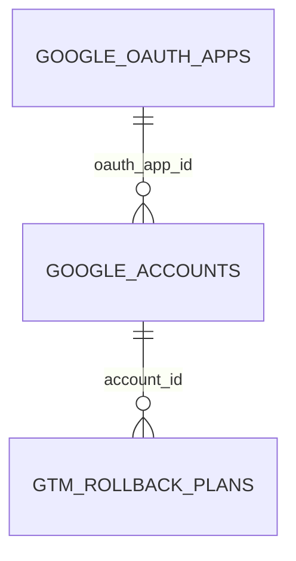

# GTM stored data overview

TL;DR: GTM uses three SQLite entities: OAuth application credentials, connected Google identities, and one-use rollback plans; GTM API resources themselves remain in Google Tag Manager (`packages/core/src/db/migrations.ts:145-190`, `packages/gtm/src/tools/gtm-rollback.ts:76-84`).

## Schema overview

`google_oauth_apps` and `google_accounts` are created by the shared core migration; rollback plans are also in that shared SQLite schema (`packages/core/src/db/migrations.ts:145-190`). The diagram shows `gtm_rollback_plans.account_id` as a logical link; the migration does not declare it as a foreign key (`packages/core/src/db/migrations.ts:177-188`). The GTM workspace reads and writes these records in a package-specific database connection (`packages/gtm/src/lib/db/accounts-repo.ts:88-99`, `packages/gtm/src/tools/gtm-rollback.ts:76-84`).

## Domain details

See [GTM credentials and rollback plans](data-model/credentials-and-rollback.md) for field meanings, relationships, lifecycle transitions, invariants, read/write use cases, and cleanup behavior.

<!-- lane-pilot:backlinks -->
## Referenced by

- [Google Tag Manager workspace overview](overview.md)
