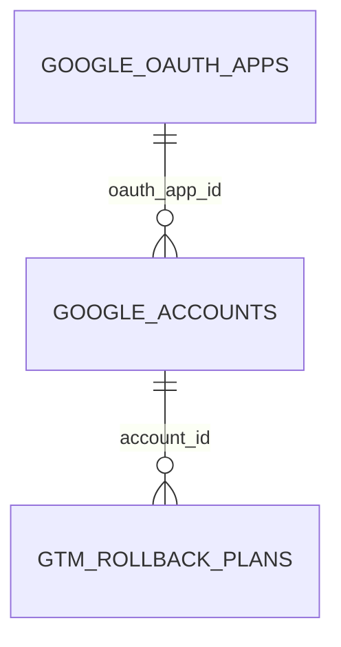

# GTM credentials and rollback plans

TL;DR: The SQLite records preserve registered OAuth clients, connected user or service-account identities, and preview state needed to safely execute a rollback (`packages/core/src/db/migrations.ts:145-190`).

## Schema overview

The schema is created in `mcp-core` migrations and accessed by GTM with the package key `gtm`; named package connections resolve package-specific database configuration (`packages/core/src/db/migrations.ts:145-190`, `packages/core/src/db/connection.ts:44-61`).

## Tables

### `google_oauth_apps`

Stores OAuth client configuration needed to start user consent. The secret is encrypted at rest and the public row omits it (`packages/gtm/src/lib/db/oauth-apps-repo.ts:16-45`, `packages/gtm/src/lib/db/oauth-apps-repo.ts:57-103`).

| Field | Meaning |
|---|---|
| `id` | Local integer primary key, assigned by SQLite (`packages/core/src/db/migrations.ts:146-147`). |
| `label` | Unique local name supplied when registering the client (`packages/core/src/db/migrations.ts:147-148`, `packages/gtm/src/lib/db/oauth-apps-repo.ts:57-87`). |
| `client_id` | Google OAuth client identifier (`packages/core/src/db/migrations.ts:148-149`). |
| `client_secret_enc` | AES-encrypted OAuth client secret; decrypted only for OAuth flow use (`packages/core/src/db/migrations.ts:149-150`, `packages/gtm/src/lib/db/oauth-apps-repo.ts:39-45`). |
| `scopes_declared` | Space-delimited scope string registered by the caller; split into scopes for the authorization URL (`packages/core/src/db/migrations.ts:150-151`, `packages/gtm/src/tools/start-google-oauth-flow.ts:37-42`). |
| `redirect_uri` | Supplied loopback redirect metadata; the actual flow creates a callback URL from the loopback listener (`packages/core/src/db/migrations.ts:151-152`, `packages/gtm/src/tools/start-google-oauth-flow.ts:34-42`). |
| `created_at` | Unix timestamp in seconds at insertion (`packages/core/src/db/migrations.ts:152-153`, `packages/gtm/src/lib/db/oauth-apps-repo.ts:64-89`). |

### `google_accounts`

Stores OAuth-user and service-account identity metadata and encrypted tokens or key material. Its label is the identifier tools use to choose a Google identity (`packages/gtm/src/lib/db/accounts-repo.ts:6-54`, `packages/gtm/src/lib/account-resolver.ts:37-47`).

| Field | Meaning |
|---|---|
| `id` | Local integer primary key (`packages/core/src/db/migrations.ts:156-157`). |
| `label` | Unique local account selector supplied by the operator (`packages/core/src/db/migrations.ts:157-158`, `packages/gtm/src/tools/start-google-oauth-flow.ts:23-28`). |
| `auth_method` | `oauth_user` for user-consent flow or `service_account` for JSON-key credentials (`packages/core/src/db/migrations.ts:158`, `packages/gtm/src/tools/start-google-oauth-flow.ts:72-81`, `packages/gtm/src/tools/register-google-service-account.ts:42-52`). |
| `oauth_app_id` | Nullable foreign key to the OAuth client used for a user-flow identity; foreign key deletion is restricted (`packages/core/src/db/migrations.ts:159`, `packages/gtm/src/lib/db/oauth-apps-repo.ts:118-143`). |
| `google_email` | Email returned from Google user info or service-account key (`packages/gtm/src/tools/start-google-oauth-flow.ts:65-80`, `packages/gtm/src/tools/register-google-service-account.ts:42-52`). |
| `google_project_id` | Project ID parsed from service-account key; null for user OAuth (`packages/gtm/src/tools/register-google-service-account.ts:42-52`). |
| `access_token_enc` | Encrypted current access token, refreshed/updated with token expiry (`packages/core/src/db/migrations.ts:162`, `packages/gtm/src/lib/db/accounts-repo.ts:164-195`). |
| `refresh_token_enc` | Encrypted OAuth refresh token; nullable when none is supplied (`packages/core/src/db/migrations.ts:163`, `packages/gtm/src/lib/db/accounts-repo.ts:125-159`). |
| `service_account_json_enc` | Encrypted original service-account JSON key; populated for service-account identities (`packages/core/src/db/migrations.ts:164`, `packages/gtm/src/tools/register-google-service-account.ts:42-52`). |
| `expires_at` | Unix expiry timestamp in seconds for the access token; `0` is the schema default (`packages/core/src/db/migrations.ts:165`, `packages/gtm/src/lib/db/accounts-repo.ts:100-159`). |
| `scopes_granted` | Space-delimited OAuth scopes returned by Google, or requested service-account scopes; checked by exact scope membership (`packages/gtm/src/tools/start-google-oauth-flow.ts:72-82`, `packages/gtm/src/tools/register-google-service-account.ts:42-52`, `packages/gtm/src/lib/account-resolver.ts:49-55`). |
| `is_default` | Integer flag (0 or 1 in repository writes) selecting the identity used when a tool omits `account`; default is 0 (`packages/core/src/db/migrations.ts:166`, `packages/gtm/src/lib/db/accounts-repo.ts:230-242`). |
| `created_at`, `updated_at` | Unix timestamps in seconds; insertion sets both and token refresh updates `updated_at` (`packages/gtm/src/lib/db/accounts-repo.ts:100-159`, `packages/gtm/src/lib/db/accounts-repo.ts:164-195`). |

### `gtm_rollback_plans`

Stores a one-use snapshot of the rollback request and live version fingerprint until confirmation or expiry (`packages/gtm/src/tools/gtm-rollback.ts:71-97`, `packages/gtm/src/tools/gtm-rollback.ts:107-124`).

| Field | Meaning |
|---|---|
| `id` | Random UUID plan identifier returned to the caller (`packages/core/src/db/migrations.ts:178`, `packages/gtm/src/tools/gtm-rollback.ts:71-89`). |
| `account_id` | Local Google account row used to authorize the preview (`packages/core/src/db/migrations.ts:179`, `packages/gtm/src/tools/gtm-rollback.ts:76-84`). |
| `gtm_account_id`, `container_id`, `workspace_id` | Google Tag Manager IDs for the selected hierarchy (`packages/core/src/db/migrations.ts:180-182`, `packages/gtm/src/tools/gtm-rollback.ts:76-84`). |
| `from_version_id`, `to_version_id` | Live version at preview and chosen target version (`packages/core/src/db/migrations.ts:183-184`, `packages/gtm/src/tools/gtm-rollback.ts:55-66`, `packages/gtm/src/tools/gtm-rollback.ts:76-84`). |
| `fingerprint` | Live-state marker captured at preview and compared before publish (`packages/core/src/db/migrations.ts:185`, `packages/gtm/src/tools/gtm-rollback.ts:55-61`, `packages/gtm/src/tools/gtm-rollback.ts:127-141`). |
| `expires_at` | Unix timestamp in seconds; preview TTL is five minutes (`packages/core/src/db/migrations.ts:186`, `packages/gtm/src/tools/gtm-rollback.ts:8-10`, `packages/gtm/src/tools/gtm-rollback.ts:71-84`). |
| `created_at` | Unix timestamp in seconds at preview creation (`packages/core/src/db/migrations.ts:187`, `packages/gtm/src/tools/gtm-rollback.ts:71-84`). |

## Lifecycle transitions

| Field or state | From | To | Function and evidence | When |
|---|---|---|---|---|
| `google_accounts.is_default` | Existing default 1 (if any); all other rows 0 | Selected account 1; former default 0 | `setDefaultAccount` (`packages/gtm/src/lib/db/accounts-repo.ts:230-242`) | `set_default_google_account` runs a transaction; a missing ID rolls back |
| OAuth app | Absent | Stored | `insertOAuthApp` (`packages/gtm/src/lib/db/oauth-apps-repo.ts:57-103`) | `register_google_oauth_app` inserts encrypted client secret |
| OAuth app | Stored and unreferenced | Deleted | `deleteOAuthApp` (`packages/gtm/src/lib/db/oauth-apps-repo.ts:118-143`) | Delete request checks that no account references the app |
| Google account | Absent | Stored | `insertAccount` (`packages/gtm/src/lib/db/accounts-repo.ts:100-159`) | OAuth callback or verified service-account registration succeeds |
| Google account tokens | Stored credentials | New access token, expiry and update time | `updateAccountTokens` (`packages/gtm/src/lib/db/accounts-repo.ts:164-195`) | Token broker refreshes the Google token |
| Google account | Stored | Deleted | `deleteAccount` (`packages/gtm/src/lib/db/accounts-repo.ts:243-246`) | Local deletion command executes |
| Rollback plan | Absent | Previewed and stored | `runGtmRollback` (`packages/gtm/src/tools/gtm-rollback.ts:49-97`) | Preview reads live and target versions |
| Rollback plan | Stored and unexpired | Claimed/deleted | `runGtmRollback` (`packages/gtm/src/tools/gtm-rollback.ts:107-118`) | Execution consumes plan before checking matching arguments and fingerprint |

## Invariants

- OAuth app label and Google account label are unique; an OAuth app with linked accounts cannot be deleted (`packages/core/src/db/migrations.ts:145-160`, `packages/gtm/src/lib/db/oauth-apps-repo.ts:118-143`).
- `auth_method` is restricted to `oauth_user` or `service_account` at the schema layer (`packages/core/src/db/migrations.ts:158`).
- Secret fields are encrypted before insertion and are excluded from public listing result types (`packages/gtm/src/lib/db/accounts-repo.ts:24-54`, `packages/gtm/src/lib/db/oauth-apps-repo.ts:16-45`, `packages/gtm/src/lib/db/oauth-apps-repo.ts:57-75`).
- Rollback plan execution deletes the plan during the claim; every unsuccessful validation after claim consumes it (`packages/gtm/src/tools/gtm-rollback.ts:107-149`).

## Writers and readers

| Data | Writers | Readers and use case |
|---|---|---|
| OAuth app rows | Register/delete OAuth app tools (`packages/gtm/src/tools/register-google-oauth-app.ts:12-46`, `packages/gtm/src/tools/delete-google-oauth-app.ts:6-38`) | OAuth flow loads client ID and decrypted secret; list returns metadata (`packages/gtm/src/tools/start-google-oauth-flow.ts:19-20`, `packages/gtm/src/lib/db/oauth-apps-repo.ts:46-56`) |
| Google account rows | OAuth callback, service-account registration, token refresh, account/default management (`packages/gtm/src/tools/start-google-oauth-flow.ts:72-82`, `packages/gtm/src/tools/register-google-service-account.ts:42-52`, `packages/gtm/src/lib/db/accounts-repo.ts:164-246`) | Resolver loads credentials and scope; list exposes metadata; GTM client requests access token (`packages/gtm/src/lib/account-resolver.ts:30-57`, `packages/gtm/src/lib/gtm-client.ts:95-108`) |
| Rollback plans | Rollback preview (`packages/gtm/src/tools/gtm-rollback.ts:71-84`) | Rollback execution claims the plan by ID and verifies its values (`packages/gtm/src/tools/gtm-rollback.ts:107-141`) |

## Retention and cleanup

The core migration creates an expiry index on `gtm_rollback_plans.expires_at`, but the GTM package defines no scheduled purge. Execution removes only the requested plan when it is unexpired; expired rows not presented for execution remain in the database (`packages/core/src/db/migrations.ts:177-190`, `packages/gtm/src/tools/gtm-rollback.ts:107-118`). Account and OAuth app deletion is explicit through their management tools; no other cleanup job appears in the GTM package (`packages/gtm/src/lib/db/accounts-repo.ts:243-246`, `packages/gtm/src/lib/db/oauth-apps-repo.ts:118-143`).

`gtm_rollback_plans.account_id` is an application-level reference to `google_accounts.id`; the migration does not declare a foreign key constraint for it (`packages/core/src/db/migrations.ts:177-188`).

<!-- lane-pilot:backlinks -->
## Referenced by

- [GTM stored data overview](../data-model.md)
- [GTM workspace gotchas](../gotchas.md)
